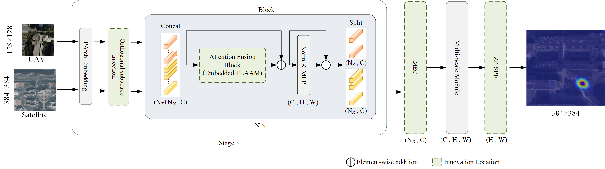

# TAME# TAME: An End-to-End UAV Self-Localization Framework Based on Visual Sensors in GNSS-Denied Environments

Official implementation of the paper **"TAME: An End-to-End UAV Self-Localization Framework Based on Visual Sensors in GNSS-Denied Environments"** (submitted to *IEEE Sensors Journal*).

TAME performs vision-based self-localization for UAVs by regressing a spatial probability heatmap over a georeferenced satellite image, without relying on GNSS signals or discrete image retrieval. Four lightweight modules adaptively modulate cross-view sensing signals at runtime, and **all of them introduce zero trainable parameters**.

## Highlights

- **Zero trainable parameters in all modulation modules** — TLAAM, OSI, and FMHead compute their statistics from runtime activations; MEC adds only ~1.0M parameters in total.
- **Large accuracy gain**: MA@3 improves by **13.7 percentage points** (0.131 → 0.268) over the strongest baseline Mix-Fusion on UL14.
- **Real-time inference**: 42.4 ms per frame (23.6 FPS) on a single consumer GPU, meeting the requirement of onboard visual sensing systems.
- **Navigation-ready output**: the probabilistic heatmap can serve as an absolute-position pseudo-measurement for EKF / factor-graph fusion with inertial sensing.

## Method Overview



TAME is built on the DRL Mix-Fusion baseline. Given a UAV-view image and a satellite search image, the pipeline is:

**Input → OSI → TLAAM (CvT backbone) → MEC → FMHead → Heatmap**

| Module | Role | Extra parameters |
|---|---|---|
| **OSI** — Orthogonal Subspace Injection | Decomposes search features into components collinear and orthogonal to the template direction, and injects the orthogonal (complementary) component proportionally | 0 |
| **TLAAM** — Triple-level Adaptive Attention Modulation | Embedded in the asymmetric hybrid attention of the CvT backbone; adjusts token-pair logit gating, head-wise dynamic temperature, and stage-wise modulation strength from runtime statistics | 0 |
| **MEC** — Multi-scale Edge Compensation | Multi-scale dilated convolution counters scale variation; a distance-based edge mask compensates boundary information loss; gated fusion balances original and enhanced responses | ~1.0M |
| **FMHead** — Feature Modulator Head | 2D sinusoidal position encoding, channel variance re-calibration, and variance-gated residual Gaussian smoothing before heatmap prediction | ~0 |

## Results on UL14

### Comparison with state-of-the-art methods

| Method | Type | MA@3 | MA@10 | MA@20 | RDS |
|---|---|---|---|---|---|
| FSRA (ViT-S) | IR / retrieval | 0.079 | 0.553 | 0.810 | 0.677 |
| Sample (ViT-S) | IR / retrieval | 0.115 | 0.601 | 0.822 | 0.712 |
| Post-Fusion | DRL / end-to-end | 0.122 | 0.598 | 0.824 | 0.731 |
| Mix-Fusion | DRL / end-to-end | 0.131 | 0.625 | 0.837 | 0.758 |
| **TAME (ours)** | DRL / end-to-end | **0.268** | **0.754** | **0.869** | **0.802** |

### Efficiency

| Model | Params | GMacs | Latency | FPS |
|---|---|---|---|---|
| Post-Fusion | 39.5M | — | — | — |
| Mix-Fusion | 20.1M | — | 43.5 ms | 23.0 |
| **TAME (ours)** | 21.1M | +1.2 | **42.4 ms** | **23.6** |

### Ablation

- Adding TLAAM / MEC / FMHead alone raises MA@3 from 0.131 to 0.211 / 0.245 / 0.201, with MEC contributing the largest single-module gain.
- OSI combined with TLAAM adds +1.6 pp on MA@3 over TLAAM alone and achieves the best RDS of 0.802.
- Performance is stable for the injection strength λ ∈ [0.05, 0.2]; the default λ = 0.1 lies in a flat region.

## Dataset: UL14

UL14 is derived from the DenseUAV dataset and designed for end-to-end heatmap regression.

- **Training set**: 6,768 UAV–satellite image pairs from 10 universities
- **Test set**: 2,331 UAV images and 27,972 satellite images from 4 universities, with no geographic overlap with the training set
- **UAV altitudes**: 80 m / 90 m / 100 m
- **Satellite scales**: 12 spatial scales

## Getting Started

### Requirements

- Python 3.8+
- PyTorch 1.12+
- timm (pretrained CvT13 backbone)
- A single NVIDIA GPU (all experiments in the paper ran on one RTX 4060)

```bash
git clone https://github.com/useryuyongbo/TAME.git
cd TAME
pip install -r requirements.txt
```

### Data preparation

Download the UL14 dataset and organize it as:

```
data/
├── train/          # 6,768 UAV–satellite pairs from 10 universities
└── test/           # 2,331 UAV images, 27,972 satellite images from 4 universities
```

### Training

```bash
python train.py \
    --data_root ./data \
    --uav_size 128 \
    --satellite_size 384 \
    --epochs 25 \
    --batch_size 8 \
    --lr_weight_decay 1.5e-4 \
    --lambda_osi 0.1
```

Training uses AdamW with weight decay 1.5×10⁻⁴ and cosine annealing. UAV images are resized to 128×128 and satellite search images to 384×384.

### Evaluation

```bash
python eval.py --weights weights/tame_ul14.pth --data_root ./data
```

This reports MA@3, MA@10, MA@20, and RDS. Visualization of predicted heatmaps and cross-attention maps is available via `--visualize`.

## Repository Structure

```
TAME/
├── models/
├── train.py
├── eval.py
├── dataloader/        # UL14 dataset loader
└── weights/
```

[//]: # (## Citation)

[//]: # ()
[//]: # (If you find this work useful, please cite:)

[//]: # ()
[//]: # (```bibtex)

[//]: # (@article{yu2026tame,)

[//]: # (  author  = {Yu, Yongbo and Jiang, Gangwu and Wei, Xiangpo and Tan, Xiong and Ma, Shunshun and Lian, Sheng},)

[//]: # (  title   = {TAME: An End-to-End {UAV} Self-Localization Framework Based on Visual Sensors in {GNSS}-Denied Environments},)

[//]: # (  journal = {IEEE Sensors Journal},)

[//]: # (  year    = {2026})

[//]: # (})

[//]: # (```)

## Contact

For questions, please open an issue or contact [yu_yb10775@163.com](mailto:yu_yb10775@163.com).
